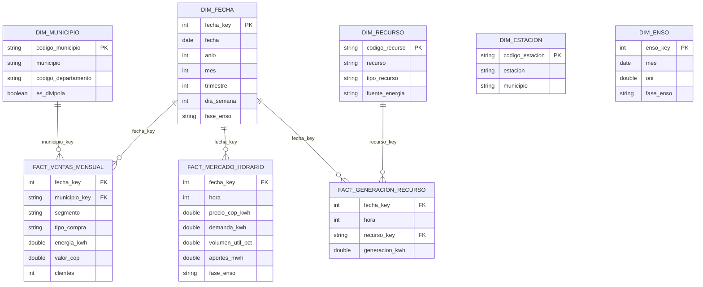

# Modelo dimensional de la capa Oro

## Esquema estrella

`dim_estacion` y `dim_enso` son dimensiones conformadas para consultas de clima y ENSO
(la medición diaria IDEAM y la serie mensual ONI quedan en Plata; no se inventa una
cuarta tabla de hechos de clima). Las pruebas de dbt verifican unicidad/no nulidad de
las claves dimensionales y relaciones de las claves foráneas declaradas.

## Grano de hechos

| Modelo | Grano | Medidas |
|---|---|---|
| `fact_ventas_mensual` | Mes, municipio, segmento y modalidad de compra EnerAndes | kWh vendidos, COP facturados y clientes |
| `fact_mercado_horario` | Fecha y hora del sistema eléctrico nacional | Precio, demanda, nivel de embalses y aportes |
| `fact_generacion_recurso` | Fecha, hora y recurso/planta XM | Generación kWh |

`fecha_key` usa `YYYYMMDD`; las fechas de venta representan el primer día del mes de
origen. `dim_fecha` cubre los días calendario de los años con ventas disponibles. El
mes central ONI (por ejemplo, DJF → enero) alimenta la fase ENSO de la dimensión fecha.
DIVIPOLA es la fuente externa municipal; los municipios de ventas no encontrados en
la referencia se mantienen identificados con `es_divipola = false` para no perder
ventas silenciosamente.
